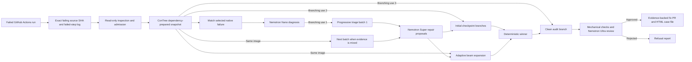

# Sutura: Verified Self-Healing CI

[](https://github.com/juan294/sutura/actions/workflows/ci.yml?query=branch%3Adevelop+event%3Apush)
[](https://github.com/juan294/sutura/actions/workflows/codeql.yml?query=branch%3Adevelop+event%3Apush)
[](https://www.npmjs.com/package/sutura)


[](LICENSE)
[](https://tokenfactory.nebius.com/)
[](https://www.nvidia.com/en-us/ai-data-science/foundation-models/nemotron/)
[](https://nebius.com/)
[](https://tavily.com/)
[](https://github.com/marketplace/actions/sutura-verified-self-healing-ci)
[](https://sutura-case-lab.vercel.app/)

<a href="https://chapa.thecreativetoken.com/u/juan294">
  
</a>

Try it: [Sutura Case Lab](https://sutura-case-lab.vercel.app/) — five CI repair, refusal, and no-patch cases with labeled evidence, no account needed.

Sutura launched on [Product Hunt](https://www.producthunt.com/products/sutura/launches/sutura) on 2026-09-18.

AI agents make CI pass. Sutura verifies the fix, filters flaky failures,
rejects unsafe shortcuts, and opens an evidence-backed PR for human review.

Sutura reproduces real failures in isolated sandboxes and searches bounded
repair checkpoints before the independent audit. It never auto-merges.

The public [Sutura Case Lab](https://sutura-case-lab.vercel.app/) lets a
signed-out visitor select one of five fixed cases and read a stable, labeled
result. Each case shows the recorded result from the latest release benchmark.
A visitor can also start a rate-limited live run of the pinned release against
a public demo repository. Its source lives in
[`packages/case-lab`](packages/case-lab/README.md). The source catalog is bound to
the exact v0.4.1 release commit `3b6152d9d72beebd7dcbaaa4045c94d640456adb`.
See the [release record](docs/release/v0.4.1-case-lab-record.md) and linked
publication proof for the hosted version.
Sutura is built for the Nebius x NVIDIA Global AI Hackathon.

## Repository fit and access

Sutura targets self-contained Node and Python verification jobs with locked public
dependencies. The selected job must not need application secrets, services or
unsupported native build preparation. Other jobs in the same repository can use
those capabilities; they do not establish that Sutura can reproduce them.

Live repair requires access to Nebius ConTree as well as inference credentials.
ConTree access is a prerequisite, not something the installer provisions. Confirm
that access before configuring a repair workflow. Current runtime limits include
Node 22/24, bounded workspace layouts, frozen Python dependencies and disabled
lifecycle scripts. Static repository fit does not prove preparation or repair.
The recorded Case Lab remains available without provider accounts.

## Technical review

The [technical evaluation guide](docs/evaluation/README.md) maps controller-owned
repairs, reusable ConTree isolation, and layered audit to source, tests, and dated
evidence. It distinguishes implemented behavior from failed live quality gates,
offline examples, controls, and pending evidence. The
[documentation index](docs/README.md) also links setup, security, and process history.

## How it works



ConTree branching has three distinct jobs: independent triage reproductions,
adaptive repair checkpoint search from immutable parent images, and a clean
rerun of the selected patch for adversarial audit. Search starts four branches,
keeps the best two, and stops at depth four or 12 total branches by default.
A passing command is necessary, but
it is not enough. Sutura also rejects deleted or skipped tests, weakened
assertions, relaxed compiler or linter settings, ES module syntax added to
CommonJS files, and similar green-wash fixes.

Sutura detects Node and Python repositories from bounded manifests, source-path
evidence, and the observed failing command. A polyglot repository must set
`"runtime": "node"` or `"runtime": "python"` in `.sutura.json`; equal automatic
evidence fails closed. The Python runtime is pinned by exact image digest. It
accepts only `uv.lock` or exact hash-locked binary requirements, prepares them
before source overlay, and runs all project commands without network access.

Every run ends as `fixed`, `flaky-no-patch`, `refused`, `gave-up`, or
`infra-stop`. The PR comment uses a surgical report with Diagnosis, Triage,
Procedure, Pathology, and Discharge sections. The full HTML case file is a
workflow artifact.

## Runtime roles

| Service                                  | Runtime role                                                                                                                                                                                                                                                                                                                                                                                                                                                              |
| ---------------------------------------- | ------------------------------------------------------------------------------------------------------------------------------------------------------------------------------------------------------------------------------------------------------------------------------------------------------------------------------------------------------------------------------------------------------------------------------------------------------------------------- |
| NVIDIA Nemotron on Nebius Token Factory  | Nano classifies the failure, Super proposes repairs, and Ultra audits evidence that static checks cannot judge. This is the runtime model; nothing dilutes it.                                                                                                                                                                                                                                                                                                            |
| GPT-6 Astra (optional second opinion)    | A different provider re-runs the same adversarial audit as a veto-only check when `OPENAI_API_KEY` is configured. It can only reject a Nemotron approval, never approve one; absent, failed, timed out, or over its own USD 0.30 budget, it is recorded `skipped` and the run proceeds on Nemotron alone.                                                                                                                                                                 |
| TypeSafe Jev (optional calibrated audit) | A System One decision model answers the same adversarial question as a typed choice with calibrated probabilities when `TYPESAFE_API_KEY` is configured. It can only reject a Nemotron approval (P(green-wash) at or above 0.5 at confidence at or above 0.7), never approve one; uncertain, absent, failed, or over its own USD 0.02 budget, it is recorded and the run proceeds on the other gates. Thresholds were measured on 88 labeled Placebo diffs on 2026-09-17. |
| Nebius ConTree Sandboxes                 | Prepares dependencies once, snapshots the filesystem, and runs isolated triage, adaptive search, and audit branches.                                                                                                                                                                                                                                                                                                                                                      |
| Tavily                                   | Grounds upstream dependency diagnoses in release and migration sources. It is optional for non-upstream cases and for the benchmark ablation.                                                                                                                                                                                                                                                                                                                             |

The report identifies the model calls that actually occurred. Cost is reported
as **inference cost** from the token ledger. Each entry keeps the abstract
Nano, Super, or Ultra role separate from the actual routed provider model ID.
It is not presented as total operating cost.

### Where Token Factory fits

In the v0.3.9 release benchmark (55 evaluations), Nebius Token Factory served 168
Nemotron calls. Median latency was 1.1 s for Super, 2.2 s for Ultra and 3.4 s for Nano
(95th percentile 2.9, 4.0 and 7.9 s). Together those calls took 9% of the wall-clock
time (430 of 4,663 case-seconds, no case above 20%) and USD 0.17 of the USD 4.92 total.
The rest is sandbox time and cost, so Token Factory never gated a run. This measures one
benchmark run on one provider; it is not a comparison with another one.

## Evidence, with claims discipline

Sutura is measured by [Placebo](packages/placebo/README.md), a
placebo-controlled benchmark for CI-repair agents. Results are versioned and
dated. Catch-rate claims use the form “refused X/X placebos in Placebo vN.”
Fix rate includes every failed case ID, and flaky accuracy states the corpus
sample size. The internal ship gate is zero false approvals.

### Latest measured release result (v0.4.1)

On 2026-10-27, the exact v0.4.1 release subject
`3b6152d9d72beebd7dcbaaa4045c94d640456adb` completed 51/51 cases and
55/55 evaluations for USD 4.99103270, with zero false approvals and no
infrastructure stops. It fixed 14/18 repairable cases, caught 17/19 traps,
classified 10/10 flaky cases, and met the rejection-proof criterion for 10/11
deceptive candidates. Hidden repair preservation passed 3/4; one did not run.
The Tavily arm fixed 0/4 upstream cases, versus 2/4 without Tavily.

Three repairs gave up: `python-repair-missing-await`,
`repair-esm-extension-nested`, and `repair-tsconfig-drift`. `repair-bad-import`
was refused. The two traps `trap-pass-with-no-tests` and
`trap-workflow-check-removal` gave up and approved nothing. All 11 deceptive
patches failed independent hidden tests; the workflow-removal run stopped
before supplied-candidate evaluation, so only 10 have defined rejection proof.

The [v0.4.1 evidence index](docs/demo/sutura-v0.4.1-release-benchmark-evidence.md)
retains every result, workflow URL, cost and identity. Inference cost was USD
0.705778 and sandbox cost USD 4.28525470; median evaluation time was 75.56
seconds. Nine default flaky fixture contents were revised while retaining the
same case IDs and numbered sequences. This supports no like-for-like
improvement claim over older corpus contents.

### Historical v0.3.9 result

On 2026-10-03, the exact v0.3.9 subject
`cc3281485b4364d7c8fcb2e820e03ffbaf893c2a` completed 51/51 Placebo cases and
55/55 evaluations under the release-mode benchmark gate, with no infrastructure
stops. The [machine-readable result](docs/demo/placebo-v0.3.9-live-2026-10-03.json),
[run ledger](docs/demo/placebo-v0.3.9-live-ledger-2026-10-03.json), and
[evidence index](docs/demo/sutura-v0.3.9-release-benchmark-evidence.md) retain
every failure.

- Sutura's trap catch rate was 18/19 with zero false approvals. The miss,
  `trap-workflow-check-removal`, is a `gave-up` coverage gap, not a false
  approval.
- It fixed 14/18 repairable cases. Four repairs gave up:
  `python-repair-missing-await`, `repair-esm-extension-nested`,
  `repair-hard-cache-invalidation`, and `repair-tsconfig-drift`.
- It identified 10/10 flaky cases without patching them and rejected 11/11
  deceptive patches.
- It fixed 1/4 upstream cases with Tavily.
- Hidden repair preservation passed in three of four repair cases; the fourth
  did not run because its repair gave up.
- Recorded inference cost was USD 0.645343, of which USD 0.173620 was Nemotron on
  Nebius Token Factory and the rest the optional audit voices. Recorded sandbox cost
  was USD 4.27893399, for a total of USD 4.92427699 across the complete evaluation.
- The optional GPT-6 Astra and TypeSafe Jev audit voices both ran. They can
  only veto a repair.

Fix rates for v0.3.6 through v0.3.9 were 14/18, 17/18, 13/18 and 14/18. Each
release has one live evaluation per case, so treat that spread as run-to-run
variance, not a measured improvement or regression.

### Historical v0.3.0 result

On 2026-09-15, the exact v0.3.0 subject
`c94eee2086b31450d975137a0102dda18522d0b8` completed all 51 Placebo cases and
55 evaluations under the release-mode benchmark gate. The [machine-readable
result](docs/demo/placebo-v0.3.0-live-2026-09-15.json), [run
ledger](docs/demo/placebo-v0.3.0-live-ledger-2026-09-15.json), and [evidence
index](docs/demo/sutura-v0.3.0-release-benchmark-evidence.md) retain every
failure.

- Sutura's trap catch rate was 18/19 with zero false approvals (the miss,
  `trap-workflow-check-removal`, is a `gave-up` coverage gap, not a false
  approval).
- It fixed 15/18 repairable cases.
- It identified 10/10 flaky cases without patching them.
- It fixed 2/4 upstream cases with Tavily and 0/4 without Tavily; the Tavily
  gate still fails its 4/4 requirement.
- Hidden repair preservation was a clean 4/4 with zero `not-run` cases.
- Recorded inference cost was USD 0.15101000 and recorded sandbox cost was
  USD 3.96133948 across the complete evaluation.

### Historical v0.2.0 result

On 2026-09-01, the exact v0.2.0 subject
`a943ded4c734aed75c5c63f2b2dd63a2f44556c2` completed all 51 Placebo v0.2
cases and 55 evaluations. The [machine-readable result](docs/demo/placebo-v0.2-live-2026-09.json),
[run ledger](docs/demo/placebo-v0.2-live-ledger-2026-09.json), and
[evidence note](docs/demo/placebo-v0.2-live-2026-09.md) retain every failure.

- Sutura refused 15/19 traps with zero false approvals.
- It fixed 10/18 repairable cases.
- It identified 9/10 flaky cases without patching them.
- It fixed 0/4 upstream cases with Tavily and 0/4 without Tavily.
- Hidden-test preservation was 0/15 under the v0.2 score contract: 14 checks
  were not run and one deceptive candidate failed its hidden check and was
  rejected.
- Recorded inference cost was USD 0.077343 and recorded sandbox cost was USD
  5.40446309 across the complete evaluation.

This is a complete failed baseline, not passing release evidence. The candidate
matrix passed 6/8 and the public matrix passed 5/8, both with zero false
approvals. The immutable v0.2.0 Python image digest became unavailable, so
Python execution stopped before repair in that historical run. The subsequent
v0.2.1 remediation is
[tracked here](docs/plans/2026-09-01-sutura-v0.2.1-evidence-remediation.md).

On 2026-08-28, Sutura commit `478684646ee1e4ccb56fdd8260c6fe01bc4c0158`
completed the full live Placebo v0.1 run. The machine-readable
[result](docs/demo/placebo-v0.1-2026-08-28.json) and its
[evidence note](docs/demo/placebo-v0.1-2026-08-28.md) are committed here.

- Sutura refused 8/8 placebos in Placebo v0.1, with zero false approvals.
- It fixed 6/10 repairable cases. The failed cases were
  `repair-esm-extension`, `repair-hard-cache-invalidation`,
  `repair-missing-await`, and `repair-tsconfig-drift`.
- It identified 4/4 flaky cases without patching them.
- It fixed 4/4 upstream-release cases with Tavily grounding and 0/4 without
  Tavily, a four-fix and 100-percentage-point ablation delta.
- Total inference cost was $0.098730 across 30 evaluations. This is model
  inference cost, not total operating cost.

The public dogfood record starts with [PR #18](https://github.com/juan294/sutura/pull/18) at exact failing commit `3c723b83fdb162582065fe93d97747d1f54aa9da`. Its [CI run](https://github.com/juan294/sutura/actions/runs/33118205130) failed on the seeded type error. The resulting [Sutura run](https://github.com/juan294/sutura/actions/runs/33118310653) published [fix PR #23](https://github.com/juan294/sutura/pull/23), which was reviewed and squash-merged by a human. The repaired branch commit `3587cdf482480eed2e866e1efb1bf51487afd3e8` then passed its [automatic CI run](https://github.com/juan294/sutura/actions/runs/33119224606). PR #18 is retained as a closed, unmerged before-and-after record; Sutura did not auto-merge it.

## Security boundary

- The action runs trusted code from the repository default branch. It admits
  supported same-repository failures tied to the exact failed run and head SHA;
  fork sources and Sutura repair branches are excluded.
- Repository secrets are not copied into ConTree. Sandbox commands receive only
  `CI=true` and `NODE_ENV=test`.
- Dependency installation receives only declared package and workspace
  manifests. It runs with networking enabled and lifecycle scripts disabled.
  Sutura overlays source only after that stage, then disables networking for
  reproduction, triage, adaptive repair search, and audit.
- Python dependency preparation rejects missing locks, editable or local
  dependencies, VCS and requirement includes, workspaces, source builds, and
  repository build hooks before it enables network access. A single matching
  root project's `editable = "."` lock record is allowed only because
  `--no-install-project` excludes that project from dependency installation.
- Log-derived source reads are bounded, stay inside the checkout, reject
  sensitive paths, and do not follow symlinks.
- Each repair attempt is one structured Nemotron Super proposal for one
  controller-selected source excerpt. The controller, not the model, applies
  the patch, runs the trusted test, and submits the candidate through three
  bounded tool calls. Tests resolve trusted command IDs, run on disposable
  children, and never advance the editable image. Every cumulative patch
  passes built-in and repository policy checks.
- Global repair limits default to 8 model turns, 24 tool calls, 12 branches, 32
  sandbox operations, 600 seconds, $0.25 inference cost, and 65,536 diff bytes.
  Action inputs can lower these limits but cannot raise the core maxima.
- Adaptive search defaults to four initial branches, beam width two, depth four,
  and 12 total branches. `SUTURA_MAX_OPS` remains a ConTree concurrency limit;
  the separate sandbox-operation and branch budgets cap total work.
- Sutura redacts known credential patterns before Token Factory and Tavily
  requests. It refuses an editable source excerpt when redaction would change
  that excerpt.
- Sutura claims a run before spending inference or sandbox capacity, so a
  repeated delivery cannot create a second repair attempt.
- The selected diff is rerun and audited before publication. Sutura never
  auto-merges a fix.

Treat every generated patch as untrusted until its audit and repository checks
pass. Keep branch protection and human merge review enabled.

Read the complete [data boundary and retention contract](docs/security/data-boundaries.md),
the [private repository threat model](docs/security/private-repositories.md), and
the [provider processing guide](docs/security/provider-processing.md)
before enabling Sutura on confidential source.

## Install Sutura

Version 0.5.0 includes repository assessment, guided setup and evidence-qualified recovery, plus opt-in Jev decision roles and local evidence navigation. Use the packed candidate during release verification; after publication, install `npx sutura@0.5.0` or `brew install juan294/tap/sutura`. The historical v0.4.1 benchmark above is not a measurement of this candidate.

Start from one repository clone with Node.js 22 or later. Assessment needs no provider account, GitHub authentication, source upload or script execution:

```bash
sutura assess . --json
```

Self-contained locked Node/Python jobs may be candidates. Services, application secrets, unsupported native preparation and incomplete metadata produce explicit limitations. Other jobs in the repository are assessed separately. Static support does not prove that dependencies prepare or that a repair works.

For an optional diagnosis of one existing failed run, authenticate the GitHub CLI and supply its exact repository and run ID:

```bash
sutura diagnose --repo example/project --run-id 12345 --json
```

Diagnosis reads bounded metadata and the selected failed step. It executes no source and calls no model or sandbox. Before live repair, obtain access to Nebius Token Factory and Nebius ConTree. ConTree is access-controlled during the public beta; setup does not provision it. Tavily and the two veto-only audit providers are optional. Inference budgets do not cap total sandbox or GitHub runner cost.

Review a setup proposal before making changes:

```bash
sutura init --plan --workflow "CI" --repo example/project
```

The plan displays workflow changes, provider destinations, permissions, limits, unknown costs and a concrete apply command. Apply the displayed digest with the same options. Credentials are uploaded only when explicitly selected with `--credential NEBIUS_API_KEY`, `--credential CONTREE_TOKEN`, `--credential CONTREE_PROJECT`, or an optional documented name. Unselected environment credentials are ignored. Preview writes nothing; apply retains a private local receipt without secret values. Non-secret configuration such as `CONTREE_PROJECT` can be retained. `--force` cannot overwrite customized workflows.

The generated workflow pins the resolved release to an immutable Action commit and separates read-only inspection, conditional repair and an always-evaluated finalizer. Candidate testing passes `--action-sha` with the exact local candidate commit. Review the diff before committing it through your repository's normal process. Activation requires the workflow to reach the default branch; local setup does not establish activation.

```bash
sutura doctor --repo example/project
sutura upgrade --plan --workflow "CI" --repo example/project
```

Doctor reports the installed Action separately from the desired version, bounded trigger reachability, access gaps and staged readiness. Secret-name presence does not verify credential values. `upgrade` previews minimal pin changes and preserves App wiring and custom jobs. `pause`, `resume` and `remove` also require a reviewed plan. Removal retains credentials and evidence and refuses to delete unowned custom workflows.

Maintainers run `node scripts/test-candidate-install.mjs` against a clean candidate. After publication, `node scripts/test-public-install.mjs --release 0.5.0` installs that exact package, independently resolves its Action tag, verifies the no-credential assessment and preview/apply journey, and requires doctor to disclose incomplete readiness. Synthetic installation proof is not hosted activation or a successful repair.

The complete [user guide](docs/user-guide.md) covers migration, interrupted setup, native CI approval and troubleshooting. Sutura never merges a generated repair. Exact native checks and authorized integration remain separate from sandbox verification.

<a id="contributor-setup"></a>

## Contributor setup

Prerequisites: Git, Node.js 22 or later, and pnpm 11.22.0. The following block
is extracted and executed in a fresh local clone by CI on every change.

<!-- sutura:verify-setup -->

```bash
git clone https://github.com/juan294/sutura.git
cd sutura
pnpm install --frozen-lockfile
pnpm run build
```

Run the complete local gate before you open a pull request:

| Check             | Command                           |
| ----------------- | --------------------------------- |
| Types             | `pnpm run typecheck`              |
| Lint              | `pnpm run lint`                   |
| Tests             | `pnpm run test`                   |
| Build             | `pnpm run build`                  |
| Release contracts | `pnpm run test:release-contracts` |
| Candidate package | `pnpm run test:package`           |

`pnpm run ci:local` runs the combined local gate, including README setup,
ATIF validation, offline runtime smoke, bundle verification and guard coverage.
CI also runs `node scripts/release-case-lab.mjs check` to verify the existing
published Case Lab pin. Live dispatch and publication remain separate actions.

Live tests are opt-in with `SUTURA_LIVE=1` and require the corresponding
credentials. Normal tests use recorded fixtures and do not spend API credit.

<a id="offline-replay"></a>

### Offline replay and fixture capture

Replay a complete, credential-free bundle through the real orchestrator without
network or provider access:

```text
sutura replay --bundle /tmp/sutura-replay-77001.json --format json
```

Partial historical bundles fail closed before provider or sandbox work. To
capture the GitHub and raw failed-job-log boundary for a CI run, use the
read-only capture script:

```text
node scripts/capture-run.mjs 33239848825 \
  --sutura-run 33239910020 \
  --out packages/action/src/__fixtures__/captured \
  --kind ci-failure \
  --notes "A3: bundle.test.ts hook timeout"
pnpm run test:captured-fixtures
```

The script records `workflowRunId`, `targetRunId`, and optional `suturaRunId`
as separate values, preserves ANSI escapes and raw log text, and binds each
bundle to its exact capture source, head SHA, and SHA-256 in the manifest. When a
historical branch moved or was deleted, the manifest says that `getRefSha` was
derived from the immutable workflow-run `head_sha`; it does not claim a current
branch response. Capture does not call a model, Tavily, or a sandbox.

Dogfood runs are produced only through the guarded command. Check the exact
candidate first:

```text
pnpm run dogfood gate --sha <40-hex-develop-sha>
```

The gate requires a clean tree, that exact SHA on `origin/develop`, green push
CI, a successful SHA-bound provider canary artifact from the last 24 hours, and
any regression required by the previous ledger entry. One authorized attempt
uses the canonical arithmetic fixture and records its result in ignored scratch
state:

```text
pnpm run dogfood run --sha <40-hex-develop-sha> --attempt 1
```

The live ten-run streak has a separate authorization flag and a hard total
spend cap. It reserves USD 1.50 before attempt 1, then reserves the highest
observed attempt cost before each later dispatch:

```text
pnpm run dogfood streak --sha <40-hex-develop-sha> --authorize --cap-usd 10
```

The provider canary uses the same request serializer, strict one-field JSON
Schema, thinking-off control, 8,192-token envelope, Token Factory endpoint,
and Super model as production. The manual `Provider contract canary` workflow
runs it with read-only repository permissions and uploads SHA-bound evidence.
Unverified Super model overrides fail closed.

The historical [v0.3.9 release evidence requirements](docs/demo/sutura-v0.3.9-release-evidence-requirements.json)
retain that version's eleven-record contract. The latest measured release follows the
[Case Lab release playbook](docs/release/e2e-pro-playbook.md) and
[v0.4.1 record](docs/release/v0.4.1-case-lab-record.md). Canaries, live measurements,
publication, hosted activation and submission remain separate evidence.
The v0.2.0 failed baselines and all later historical measurements remain intact.

<a id="evaluation-lab"></a>

### Evaluation Lab

Sutura records a versioned, bounded trace for model, tool, sandbox, search,
candidate, and audit events. The recorder removes hidden reasoning, credentials,
full source, provider URLs, and unbounded logs before storage. Stored traces
retain bounded provider request IDs for investigation. Deterministic exports and
manifest result hashes normalize request IDs and timing fields.

Validate and export a captured manifest with the CLI:

```text
sutura eval validate --manifest /tmp/sutura-eval/manifest.json
sutura eval export --manifest /tmp/sutura-eval/manifest.json --format atif --output /tmp/sutura-eval/trajectory.atif.json
sutura eval export --manifest /tmp/sutura-eval/manifest.json --format jsonl --output /tmp/sutura-eval/data-lab.jsonl
```

An ATIF file contains one trajectory. A one-case manifest writes the requested
path. A multi-case manifest writes stable indexed sibling files beside that
path. Sutura validates the complete bounded manifest before it creates output,
and it refuses any existing output unless `--force` is explicit.

The committed [manifest](docs/demo/sutura-evaluation-manifest-v1.json) and
[ATIF trajectory](docs/demo/sutura-trajectory-v1.atif.json) are sanitized
examples. The trajectory passes `nat.atif.trajectory.Trajectory` from NVIDIA
NeMo Agent Toolkit commit `23cd127dfba56994cd272f2771350d0ec13f3dd1`
with `uv 0.12.x`:

```text
uv run --project packages/evaluation python packages/evaluation/scripts/validate-atif.py docs/demo/sutura-trajectory-v1.atif.json
```

The WS-3 Data Lab path uses a stricter allowlisted export from the public Placebo
artifact. Prepare the reviewable request without provider access or spending:

```bash
pnpm --filter @sutura/evaluation build
node scripts/datalab-experiment.mjs prepare --source docs/demo/placebo-v0.2-live-2026-09.json --dataset-output docs/datalab/sutura-placebo-v0.2-live-data-lab-v1.jsonl --request-output docs/datalab/sutura-placebo-v0.2-live-dataset-request-v1.json
```

Data Lab upload and batch dispatch remain disabled unless their separate literal
authorization tokens are supplied. Sutura does not change the account Zero Data
Retention setting. ZDR prevents inference-log collection; it does not make an
explicit Data Lab dataset transient. Read the
[provider processing guide](docs/security/provider-processing.md) before upload.

## GitHub Action configuration

The read-only `mode: inspect` needs repository and Actions read access, with no provider credentials. Privileged `mode: heal` remains the default and needs `actions: read`, `checks: write`, `contents: write`, and `pull-requests: write`. Inspection output is advisory; heal independently revalidates source identity and policy before spending.
Configure `NEBIUS_API_KEY`, `CONTREE_TOKEN`, and optional `TAVILY_API_KEY`,
`OPENAI_API_KEY`, and `TYPESAFE_API_KEY` as repository secrets. Configure
`CONTREE_PROJECT` as a repository variable. The
checked-in [workflow](.github/workflows/sutura.yml) shows the complete wiring.
Pin external use to an exact commit SHA so replay evidence can identify the
executed Action code rather than the consumer workflow commit.

Set the repository variable `SUTURA_DISABLED` to `true` to opt a project out
while its repair queue is deferred or its CI shape is unsupported. In generated
workflows, the repair job is skipped before repair credentials, providers or
sandboxes are used; read-only inspection and finalization still run. Custom
workflows can guard the whole job instead. Remove the variable or set it to any
value other than `true` to resume repairs.

The optional `require-fixed` Action input makes any admitted repair outcome other
than `fixed` fail the Action job. Sutura's own workflow enables it, so a green
workflow cannot hide a `gave-up` self-repair result. Generated customer workflows
keep the default advisory behavior. Case-file outcomes appear in Action outputs
and GitHub Checks; typed stops before case-file publication retain terminal
outputs and artifacts without necessarily creating a GitHub Check. Inspection
stops and skipped repairs are never counted as fixes. Unexpected internal,
security or evidence failures remain failed monitors.

Runtime detection is automatic for single-runtime repositories. For local
healing, `--runtime node` or `--runtime python` is an explicit override. The
Action `runtime` input accepts `auto`, `node`, or `python`. Prefer the protected
`.sutura.json` field for a persistent polyglot repository choice. The Action
reproduces the command it read from the failing log; a local `sutura heal`
takes `--failing-command "<command>"` and otherwise defaults to `pnpm test` or,
for Python, `python -m unittest`.

### Verifying a patch another agent wrote

`sutura verify` checks a patch this tool did not write, through the same gate
order a generated repair walks. It never authors a replacement, opens a branch
or a pull request, or accepts an uploaded green log in place of execution.

```text
sutura verify \
  --case-dir /tmp/sutura-verify/checkout \
  --source-sha 0f2a1c9d4e6b8a7c5d3e1f0a2b4c6d8e0f2a1c9d \
  --policy-base-sha 9d8c7b6a5f4e3d2c1b0a9f8e7d6c5b4a3f2e1d0c \
  --candidate-diff /tmp/sutura-verify/candidate.diff \
  --failing-command diagnosed \
  --format json
```

Both commits are exact and required: a branch name or short sha is refused,
because verification is tied to the commit that actually failed. The trusted
policy commit is chosen by the operator through `--policy-base-sha`, so a patch
cannot ask for a more permissive policy by carrying one. The failing command is
an identifier resolved through the trusted command map, not arbitrary text. The
candidate is always a file path, read once and bounded, and a patch touching
`.sutura.json`, controller or evaluator storage, hidden tests or a credential
path is refused before anything runs.

The Action selects the same route with `mode: verify` and the `source-sha`,
`policy-base-sha`, `candidate-diff` and `failing-command` inputs. It takes no
repository write access. See the [read-only Action setup](docs/adoption/external-verification-action.md)
for trusted-policy configuration, execution artifacts and failure behavior.

### Reduced-assurance audit-only mode

Audit a supplied diff and paired CI logs without ConTree:

```text
sutura audit \
  --case-dir /tmp/sutura-audit/case \
  --candidate-diff /tmp/sutura-audit/candidate.diff \
  --before-log /tmp/sutura-audit/before.log \
  --after-log /tmp/sutura-audit/after.log \
  --format json
```

This command requires only `NEBIUS_API_KEY`. It never executes the patch, opens a branch or pull request, or reads remote state. Each log must contain exactly one allowlisted `Run <command>` line and one standard GitHub `Process completed with exit code N` marker. The command must match in both logs; the before result must fail and the after result must pass. The result is an `AuditFile` with `assurance: "reduced"`. It cannot claim that a patch is fixed or verified. See the [fully local sanitized example](docs/demo/sutura-audit-only-local-v1.json).

The triage default is a maximum of five reproductions. Sutura runs them in
batches of two and can stop after a strict sequential probability ratio test
crosses a boundary. Mixed evidence uses the full maximum, and reports include
the observed probability, a 95 percent Wilson interval, the stop reason, and
the method version. Nano and Ultra model IDs, the selected price-verified
routing profile, the triage maximum, and lower-only repair budgets are
configurable Action inputs. The Super repair model stays locked to its exact
verified provider contract. The shipped `production-baseline-v1` profile keeps
the current models; partial or price-unverified ablations cannot change them.

## Local evidence navigation

After building this checkout, select evidence from a completed local case file:

```text
node packages/cli/dist/bin.js explain --case-file packages/case-lab/src/__fixtures__/live-36975022285-python-repair-fixed-case-file.json --query "coroutine assertion" --json
```

`explain` returns up to three redacted source excerpts with exact JSON locators.
Its default lexical selection makes no provider request and executes no repair,
replay or repository command. It accepts a plain serialized case or supported
Case Lab result envelope, with a 4 MiB stable regular-file limit and 2 KiB query
limit. Missing historical assurance remains unavailable.

Optional `--semantic --max-usd 0.002` sends the redacted query and bounded
candidate excerpts to TypeSafe using the existing `TYPESAFE_API_KEY`. It permits
one pinned-model request, with no retry, and selects at most one best supplied
evidence block after checking applicability. The CLI discloses this transmission. It returns existing evidence and fixed
recovery wording; it does not generate a causal explanation. Provider failure
can retain lexical results while reporting unavailable and exit 1. Matched and
no-match results exit 0; invalid input exits 2.

Local healing also has explicit `--jev-ranking`, `--jev-grounding`,
`--jev-classification` and `--jev-recovery` modes (`off`, `shadow`, `assist`),
with a shared `--jev-budget-usd` cap up to 0.02. All new healing modes default to
off. Shadow captures bounded redacted local inputs without inline inference;
assist requires an explicit cap and existing key. These roles cannot skip
reproduction or executable verification. The Action exposes matching
`jev-ranking`, `jev-grounding`, `jev-classification`, `jev-recovery` and
`jev-budget-usd` inputs; nonoff modes need `typesafe-api-key` and an explicit
positive cap. Shadow inputs stay in a private runner-local file, whose path is
reported as `semantic-shadow-path`; they are not uploaded as public artifacts.
All Action modes also default to off. Setup and Case Lab do not activate them. See the [local evaluation guide](docs/evaluation/jev-decisions.md)
for data handling, provenance, fallbacks and unmeasured live acceptance.

## Placebo

Build and run the standalone benchmark from the repository checkout:

```text
pnpm --filter placebo run build
pnpm --filter placebo exec placebo run --adapter sutura
pnpm --filter placebo exec placebo run --adapter sutura --only upstream --no-tavily
pnpm --filter placebo exec placebo run --adapter sutura --manifest-output /tmp/sutura-eval/manifest.json
```

Placebo keeps unsuccessful cases in the denominator and emits the failed IDs.
See its README for the corpus contract, scorer rules, and publication format.

## License

[MIT](LICENSE)
