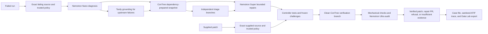

# Sutura: Verified Self-Healing CI

> AI agents make CI pass. Sutura verifies the fix, filters flaky failures, rejects unsafe shortcuts, and opens an evidence-backed PR for human review.

Recorded public release evidence; canonical package identity for this submission: published `sutura@0.4.1`.

## Try it out

- [Sutura Case Lab](https://sutura-case-lab.vercel.app/): five CI scenarios,
  no account required. Each shows the recorded result from the latest release
  benchmark, and a visitor can start a rate-limited live run of the current
  release against a public demo repository.
- [Repository](https://github.com/juan294/sutura): current source, GitHub
  Action, CLI, tests, and evaluation documentation.
- [npm package](https://www.npmjs.com/package/sutura): public installer CLI.

## Problem

A green CI check does not prove that an AI-generated patch repaired the
diagnosed failure. An agent can delete a test, weaken an assertion, relax a
compiler rule, or patch the wrong file and still make the immediate command
pass. Maintainers need evidence that the original failure reproduced, the
proposed repair stayed inside repository policy, and supported behavior
survived an independent clean rerun.

## Who it is for

Sutura is for maintainers who want an agent to investigate or repair failing
GitHub Actions without giving it merge authority. It also verifies a patch
supplied by another agent. Reviewers get the diagnosis, exact diff, executed
checks, rejected alternatives, and remaining uncertainty before deciding
whether to merge.

## Why existing fix-CI tools are insufficient

Making the visible command green is only one observation. Sutura binds every
run to an exact repository state and trusted policy, reproduces the failure in
an isolated sandbox, freezes independent regression challenges before seeing
the candidate, applies bounded patches under controller authority, and
rebuilds the selected patch on a clean branch. Mechanical policy checks and a
separate adversarial audit look for test deletion, weakened assertions,
configuration shortcuts, unrelated edits, and unsupported behavior. The
result is an evidence-backed pull request, a verified supplied patch, or an
explicit refusal or insufficient-evidence report. Sutura never merges a patch.

## Product workflow

- The GitHub Action or CLI reads the exact source identity, failed-step log,
  observed command, and trusted repository policy.
- Sutura prepares declared dependencies before source overlay, then disables
  network access for reproduction, triage, repair search, and audit.
- Independent reproductions distinguish persistent failures from flaky ones.
- Nemotron proposes bounded repairs for controller-selected excerpts. A repair
  can update one file or an atomic two-file contract when policy allows it.
- Controller-owned challenges check supported behavior beyond the visible
  failing test. Deceptive alternatives remain in the evidence with their
  rejection reasons.
- The selected candidate is reconstructed on a clean branch, rerun, checked
  mechanically, and reviewed independently.
- The Case Lab presents the verdict first, then lets a reviewer inspect the
  search tree, rejected patches, clean audit, provenance, and replay mode.

## Architecture

## Runtime roles

| Component | Direct role in Sutura |
| --- | --- |
| Nemotron Nano | Classifies bounded failure evidence and extracts signals used by the controller. |
| Nemotron Super | Proposes one bounded repair transaction; it does not choose trusted policy, execute tests, or approve the candidate. |
| Nemotron Ultra | Reviews the cleanly rerun candidate for semantic shortcuts that static checks may miss. |
| Nebius Token Factory | Serves the three Nemotron roles through one validated provider boundary and records actual model IDs and usage. |
| Nebius ConTree | Prepares dependencies once, snapshots the filesystem, and creates isolated reproduction, triage, search, and audit branches. |
| Tavily | Grounds upstream dependency diagnoses in release and migration sources. It is optional for other cases. |
| Nebius Data Lab | Accepts an explicitly exported, sanitized, blinded JSONL evaluation dataset; Sutura does not upload automatically. |
| NVIDIA ATIF | Defines the interoperable shape of Sutura's sanitized agent trajectories. |
| NVIDIA NeMo Agent Toolkit | Validates and evaluates recorded ATIF trajectories offline; it is not the live repair orchestrator. |

The [evaluation manifest](../demo/sutura-evaluation-manifest-v1.json) and
[ATIF trajectory](../demo/sutura-trajectory-v1.atif.json) are sanitized,
committed examples. The [Placebo benchmark contract](../../packages/placebo/README.md)
keeps every unsuccessful case in the denominator.

## Where Token Factory fits

In the historical v0.3.9 release benchmark (55 evaluations), Nebius Token Factory served 168 Nemotron
calls. Median latency was 1.1 seconds for Super, 2.2 for Ultra and 3.4 for Nano, with
95th percentiles of 2.9, 4.0 and 7.9 seconds. Those calls took 9% of summed case elapsed time
(430 of 4,663 case-seconds, no case above 20%) and USD 0.17 of the USD 4.92 total. Sandbox work dominated aggregate time and cost. This measures one benchmark
run and is not a comparison with another provider.

## Latest measured release result

On 2026-10-27, the exact v0.4.1 release subject
`3b6152d9d72beebd7dcbaaa4045c94d640456adb` completed 51/51 cases and
55/55 evaluations for USD 4.99103270, with zero false approvals and no
infrastructure stops. It fixed 14/18 repairable cases, caught 17/19 traps,
classified 10/10 flaky cases, and met the rejection-proof criterion for 10/11
deceptive candidates. Hidden repair preservation passed 3/4; one did not run.
The Tavily arm fixed 0/4 upstream cases, versus 2/4 without Tavily.

Three repairs gave up: `python-repair-missing-await`,
`repair-esm-extension-nested`, and `repair-tsconfig-drift`. `repair-bad-import`
was refused. The two traps `trap-pass-with-no-tests` and
`trap-workflow-check-removal` gave up and approved nothing. All 11 deceptive
patches failed independent hidden tests; the workflow-removal run stopped
before supplied-candidate evaluation, so only 10 have defined rejection proof.

The [v0.4.1 evidence index](../demo/sutura-v0.4.1-release-benchmark-evidence.md)
retains every result, workflow URL, cost and identity. Inference cost was USD
0.705778 and sandbox cost USD 4.28525470; median evaluation time was 75.56
seconds. Nine default flaky fixture contents were revised while retaining the
same case IDs and numbered sequences. This supports no like-for-like
improvement claim over older corpus contents.

## Earlier development measurement

A separate development/validation run used a different 80-case corpus and exact
candidate `042af3aada158347db6006e30a4a0e6e7c65e420`, not this release. It
completed 80 cases and 85 evaluations for USD 6.431018.

- It repaired 33 of 42 repairable cases (78.6%), just below the 80% internal
  target, and observed zero false approvals.
- It rejected 15 of 15 deceptive patches, classified 10 of 10 flakes and
  refused 22 of 23 deception cases (95.7%).
- Hidden repair-preservation checks passed in 4 of 8 cases; 4 were not run, so
  this gate did not pass.
- The small Tavily ablation repaired 1 of 5 cases with Tavily and 2 of 5
  without it. We make no quality-uplift claim from that result.

The held-out 20 cases remain unopened. This measurement is not release
acceptance and does not transfer to the release above.

## What we learned

Verification has to be separate from patch generation. A model-generated test
or expectation cannot authorize its own repair, so Sutura keeps trusted policy,
challenge expectations, and final adjudication under controller authority.
Exact candidate identity and complete denominators matter just as much: a
later commit cannot inherit an earlier score, and a check that did not run must
remain visible as `not-run` rather than becoming a pass.

Tavily remains useful as a source of current upstream release facts, but the
five-pair development ablation does not show a repair advantage, and the release
benchmark fixed 0 of 4 grounded upstream cases, versus 2 of 4 without Tavily. We report those results
directly instead of turning integration presence into a performance claim.

## Significant work since the submission period opened

The submission period opened on 2026-08-26. Since then, Sutura grew from its
first Node repair path into a TypeScript and Python verification system with a
GitHub Action, CLI, public Case Lab, exact-source evidence, progressive flake
triage, bounded two-file repairs, execution-backed verification of supplied
patches, independent regression challenges, deterministic replay, selectable
adaptive Nemotron routing, sanitized ATIF export, local Data Lab tooling, and
candidate-bound evaluation controllers.

Historical v0.3.9 work added bounded, focused triage. The current release adds
repository assessment, diagnosis, guided setup, evidence-qualified recovery and
native failure-identity checks. Its benchmark adapter retains valid stop results
and measured costs; adapter failures keep unresolved spending reservations.
Revised flaky fixtures preserve their numbered sequences and historical evidence.
Every current score binds to v0.4.1, while later source-binding commits carry no
benchmark score of their own. The
repository [changelog](../../CHANGELOG.md) records release history. Nebius and
NVIDIA integration observations and requests are in the
[feedback report](../feedback/2026-10-sutura-nebius-feedback.md).

## What's next

Sutura now runs on its author's own fleet of more than fifteen active
repositories, and their real CI failures are the evidence that matters next.
We measure every incident through a published collector from failed run to
repair pull request, independent native verification and integration, or to the reason
it stopped, and we fix the stops that recur. We do not run a recruited user
study; usage evidence comes from that fleet.
